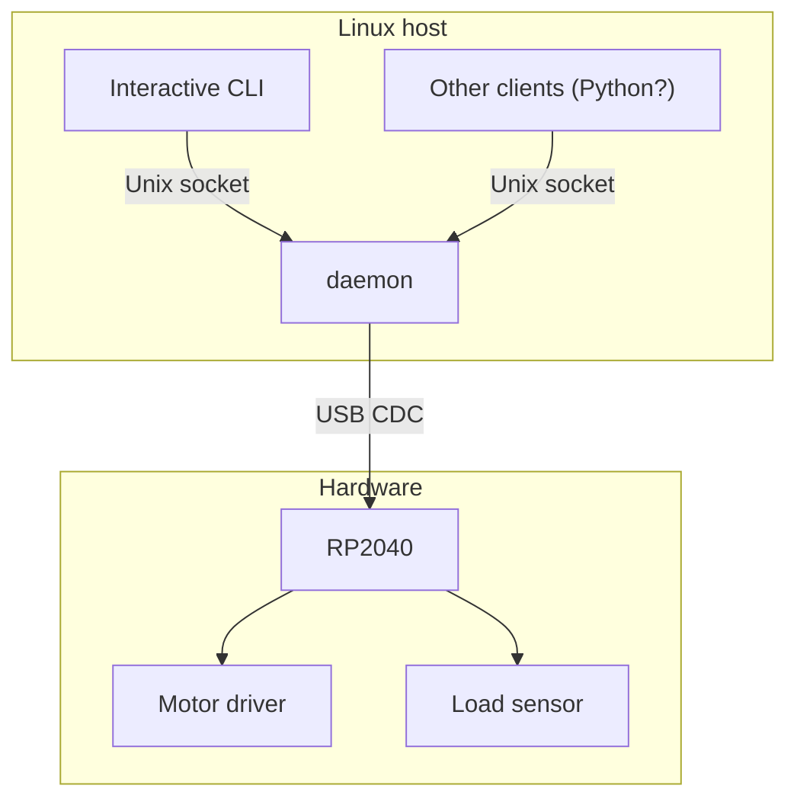

# Design docs

Design documentation and record. Guides project as a standard to be continuously check against. All code changes must follow these documents. Also allows traceability from code.

For build and usage instructions, see the top-level `README.md` instead.

## System architecture

The system has two components, a daemon on a Linux host and firmware for RP2040.

## File content

Each system component is documented by an intent / spec / implementation triplet.

- `intent.md`: What we want to do, and what is deliberately non-goal.
- `spec.md`: How should the system behave, and what (testable) requirements must be met.
- `impl.md`: How current code satisfies the spec, incl. architecture, modules, data flow, and known gaps. 

## Rules

1. Each commit must reflect changes in the design docs.
2. Requirements in `spec.md` must be labelled. `impl.md` should use these labels.
3. Design decisions need to be documented in decision record in `intent.md`. Each decision shall include 'decision', 'context', 'why', and 'alternative' fields. This ensures traceability.
